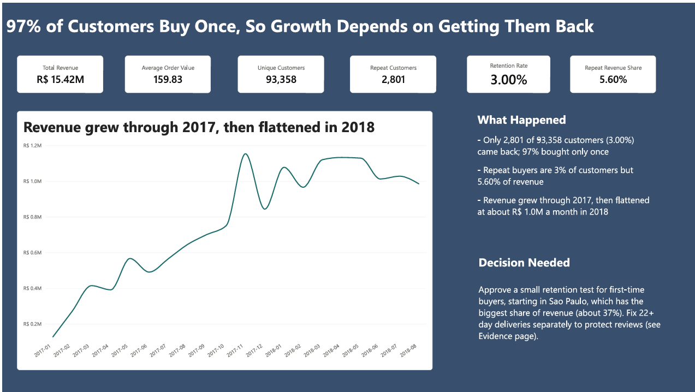
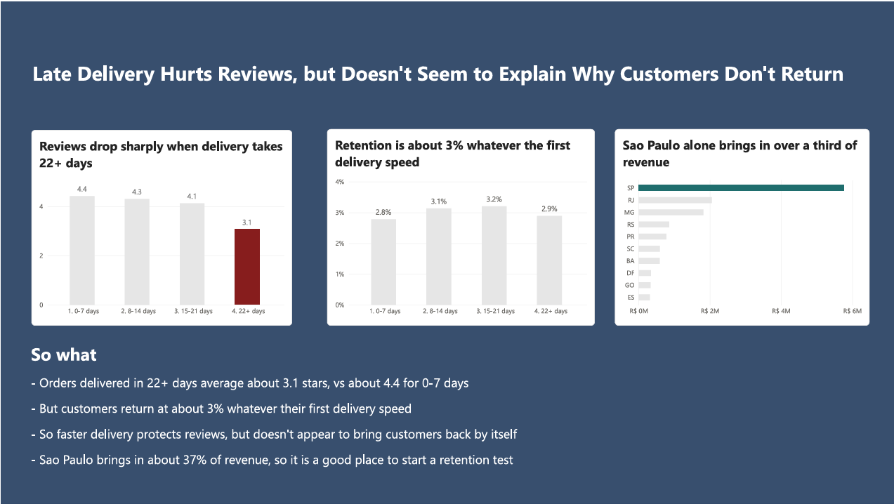

# Customer Retention Dashboard

**97% of 93,358 customers bought only once (retention 3.00%). The 3% who came back bring 5.60% of revenue.**
**Deliveries of 22+ days cut review scores from about 4.4 to 3.1, but retention stays near 3% at every delivery speed.**



Built with SQL Server (T-SQL), Python (pandas, SQLAlchemy, scipy) and Power BI (DAX).

---

## Problem

Revenue grew through 2017 and then flattened at about R$ 1.0M a month in 2018, while almost no customers came back. This project asks two questions:

1. How many customers come back, and how much are they worth?
2. Is slow delivery the reason customers do not come back?

The data is real order data from an online marketplace in Brazil (see Data credit). Money is in Brazilian reais (R$).

## Key findings

**How retention is measured:** a customer is one `customer_unique_id`. A repeat customer has more than one **delivered** order. Cancelled, unavailable and other undelivered orders are left out.

- **Retention is 3.00%:** 2,801 of 93,358 customers ordered more than once.
- **Repeat buyers are worth more than their number:** they are 3% of customers and bring 5.60% of revenue.
- **Revenue:** R$ 15.42M in total (item price plus freight, delivered orders only). Average order value is R$ 159.83.
- **Delivery hurts reviews:** orders delivered in 0-7 days average about 4.4 stars, 8-14 days 4.3, 15-21 days 4.1 and 22+ days 3.1. Across all delivered orders, delivery days and review score have a correlation of r = -0.334 (`src/stats_analysis.py`).
- **Delivery does not seem to explain retention.** Customers grouped by the speed of their first delivery came back at 2.8% (0-7 days), 3.1% (8-14 days), 3.2% (15-21 days) and 2.9% (22+ days).
- **Sao Paulo (SP) brings in about 37% of revenue,** the biggest share of any state.
- **Payment type (Python t-test):** credit card payments average R$ 163.32 per payment against R$ 145.03 for boleto (p < 0.00001). This compares two groups of payments. It is not a controlled experiment.
- **Recommendation:** run a small retention test for first-time buyers, starting in Sao Paulo, and fix 22+ day deliveries separately to protect reviews.

## Dashboard screenshots

**Page 1: Summary**


**Page 2: Evidence**



The Power BI file is not included in this repo because it holds a copy of the dataset. The screenshots show both pages.

## Pipeline

CSV → Python cleaning → SQL Server → Power BI

1. **CSV:** the public Olist dataset (see Data credit). The raw files are not included in this repo.
2. **Python cleaning (pandas):** `src/ingest.py` reads 8 of the 9 CSV files (the large geolocation file is skipped because the KPIs do not need it). `src/clean.py` cleans each table: it removes duplicate rows (none were found, so no rows were lost), turns date columns into real dates, turns price and payment columns into numbers, standardizes text (lowercase cities, uppercase state codes, trimmed spaces), fills missing review comments with empty text, labels products with no category as "unknown", and fills missing product weights and sizes with the column median.
3. **SQL Server:** `src/load_db.py` loads the 8 cleaned tables into the `olist_analytics` database. `sql/01_kpis.sql` holds 7 KPI queries in T-SQL.
4. **Python statistics:** `src/stats_analysis.py` runs the correlation, the cohort and retention analysis, and a t-test.
5. **Power BI:** connects to SQL Server. The model links 8 tables (customers, orders, order items, payments, reviews, products, sellers, category translation) with one-to-many relationships. The report logic is written in DAX:
   - Measures: `Unique Customers`, `Repeat Customers`, `Retention Rate`, `Repeat Revenue Share`, `Average Review Score`
   - Calculated columns: `Delivery Days`, `Delivery Bucket`, `Customer Type`, `First Order Date`, `First Delivery Bucket`

```
src/    config.py, ingest.py, clean.py, load_db.py, stats_analysis.py
sql/    01_kpis.sql
docs/   dashboard screenshots
```

## Tools and skills

- **SQL Server (T-SQL):** the `olist_analytics` database and 7 KPI queries
- **Python:** pandas (cleaning), SQLAlchemy (loading into SQL Server), scipy (correlation and t-test)
- **Power BI:** DAX measures and calculated columns, data modelling, report design
- **Data storytelling:** an action title on each page, one highlight color per message, and a clear "Decision needed"

## How to run

**You need:** Windows, Python 3.9 or newer, SQL Server (Express or Developer), ODBC Driver 18 for SQL Server, and Power BI Desktop if you want to rebuild the report. SSMS is optional but useful.

1. Clone the repo and open the folder:
   `git clone https://github.com/Kaveesha20/CustomerRetentionDashboard.git`
   `cd CustomerRetentionDashboard`
2. Download the dataset from Kaggle (link below) and put the CSV files in `data/raw/`.
3. Create the environment: `python -m venv .venv`, activate it (`.venv\Scripts\activate`), then `pip install -r requirements.txt`.
4. In SQL Server, create an empty database named `olist_analytics` (in SSMS: right-click Databases, then New Database, or run `CREATE DATABASE olist_analytics;`).
5. Copy `.env.example` to `.env` and set `DB_SERVER` (for example `localhost\SQLEXPRESS`) and `DB_NAME=olist_analytics`. The connection uses your Windows login, so no password is needed.
6. Run `python src/load_db.py`. This reads the CSV files, cleans them and creates the 8 tables in SQL Server.
7. Optional: run `sql/01_kpis.sql` in SSMS for the 7 KPI queries, and `python src/stats_analysis.py` for the correlation, retention and t-test results.
8. To rebuild the dashboard, open Power BI Desktop, connect to your SQL Server database and load the 8 tables.

## Limitations

- **About two years of data.** The revenue trend shows January 2017 to August 2018. The months outside that range have very few orders and are left out.
- **Customers who first bought late had less time to come back,** so true retention could be a little higher than 3%.
- **The data comes from one marketplace,** so the results may not apply to other kinds of business.
- **The delivery link is an association, not a cause.** Slow delivery goes with lower reviews, but the data does not prove that it caused them, or that fixing delivery would change retention.
- **Retention is not compared to any benchmark,** and no revenue projection was made.
- **Delivered orders only,** and customers are identified by `customer_unique_id`. A person who buys under two different accounts is counted as two customers.

## Data credit

Brazilian E-Commerce Public Dataset by Olist, on Kaggle: https://www.kaggle.com/datasets/olistbr/brazilian-ecommerce

Licence: CC BY-NC-SA 4.0. The raw data is not included in this repository. Download it from the link above.
